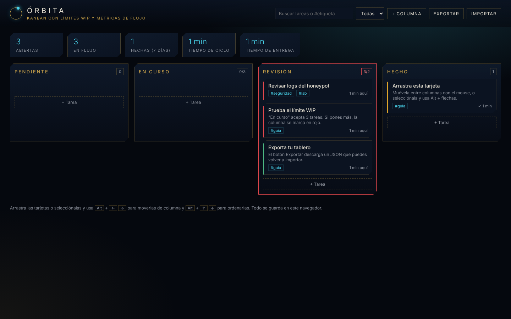

# Órbita — Kanban con límites WIP y métricas de flujo

Tablero Kanban hecho con HTML, CSS y JavaScript puro: sin frameworks, sin dependencias y sin servidor. Todo se guarda en el navegador.



## Por qué otro Kanban

La mayoría de tableros son listas de tareas con columnas. Kanban de verdad tiene dos ideas más, y este tablero las implementa:

- **Límite WIP por columna.** Cada columna puede tener un máximo de tareas en curso. Si se supera, la columna se marca en rojo: el objetivo es terminar antes de empezar más.
- **Métricas de flujo.** Cada tarjeta guarda cuándo entró a cada columna. Con eso el tablero calcula:
  - **Tiempo de ciclo:** desde que la tarea empieza a trabajarse hasta que se termina.
  - **Tiempo de entrega:** desde que se crea hasta que se termina.
  - Tareas abiertas, en flujo y terminadas en los últimos 7 días.

## Funciones

- Columnas configurables: nombre, límite WIP y si marcan la tarea como terminada.
- Tarjetas con título, descripción, prioridad, fecha de vencimiento (las vencidas se resaltan) y etiquetas.
- Arrastrar y soltar entre columnas y dentro de una columna.
- Teclado: selecciona una tarjeta y usa `Alt` + `←` `→` para cambiarla de columna, `Alt` + `↑` `↓` para ordenarla y `Enter` para editarla.
- Búsqueda por texto o por `#etiqueta` y filtro por prioridad.
- Exportar e importar el tablero en JSON, con validación del archivo.
- Guardado automático en `localStorage`; si el navegador no lo permite, la app sigue funcionando en memoria.

## Módulos

| Módulo | Qué hace |
|---|---|
| Tablero | El Kanban: límites WIP, métricas, arrastre, teclado, búsqueda, exportar/importar |
| Enfoque | Pomodoro ligado a una tarea del tablero (cada sesión suma en la tarjeta), descansos largos cada 4 ciclos, historial y totales de hoy y de 7 días, aviso con sonido y notificación |
| Agenda | Calendario mensual con eventos y alarmas, y las tareas del tablero que vencen cada día |
| Integraciones | Clima (OpenWeatherMap), Spotify (estado, reproducir/pausar/saltar con PKCE, o una playlist incrustada sin cuenta) y un asistente con Gemini que divide una tarea en subtareas o resume el tablero |
| Ajustes | Claves de API propias |

## Claves de API

Las integraciones usan **tus propias claves**, que se escriben en Ajustes y se guardan solo en el `localStorage` de tu navegador. No están en el código ni en el repositorio.

- **OpenWeatherMap:** API key gratuita de openweathermap.org.
- **Spotify:** solo el Client ID de una app en developer.spotify.com. Registra como Redirect URI la URL donde abras Órbita (la pantalla de Ajustes te la muestra). El flujo es Authorization Code con PKCE, así que no hay secreto en el navegador. Controlar la reproducción requiere Spotify Premium; la playlist incrustada funciona sin cuenta.
- **Gemini:** API key de aistudio.google.com. Restríngela por dominio (HTTP referrer) en la consola de Google, porque una clave usada desde el navegador es visible para quien use ese navegador.

## Usarlo

Abre `index.html` en el navegador. No hay nada que instalar.

## Estructura

```
index.html   estructura y diálogos
styles.css   tema visual
app.js       tablero: estado, métricas, arrastre, teclado, exportar/importar
modulos.js   enfoque, agenda, integraciones y claves
```

## Licencia

[MIT](LICENSE) © 2026 James V (Dio77799)
